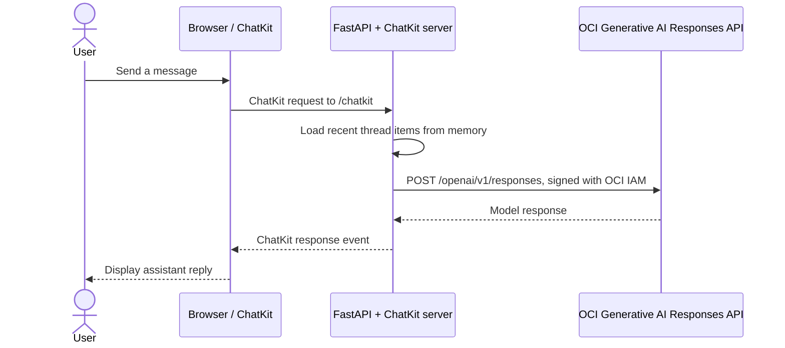

# OCI Generative AI + OpenAI ChatKit + Streamlit

A proof of concept that puts an OpenAI ChatKit interface in front of the OCI Generative AI Responses API. Streamlit provides a small launch and connection-status page; a Python FastAPI service hosts ChatKit's custom backend and signs OCI requests with OCI IAM.

**Model requests go to OCI.** The browser loads the ChatKit web component from OpenAI's CDN, but the model is called through OCI and the OCI IAM signing credentials stay on the Python backend. This project does not use an OpenAI API key, an OpenAI-hosted Agent Builder workflow, or Codex sign-in.

For the code-level architecture and request walkthrough, see [How the ChatKit + Python + OCI Responses API sample works](docs/ARCHITECTURE.md).

## How ChatKit is integrated with Python and OCI

The integration has three parts. **ChatKit** is the browser chat UI and message protocol. **FastAPI and the Python ChatKit SDK** receive each message and build the conversation input. **The OpenAI Python SDK** sends that input to OCI's OpenAI-compatible Responses API endpoint. OCI IAM signing is only how the Python backend authenticates that HTTP request; it is not the ChatKit integration itself.

The code path is:

1. The ChatKit web component in `/ui` posts a ChatKit request to FastAPI's `/chatkit` route.
2. `/chatkit` passes the request to `ChatKitServer.process()`.
3. `OciChatKitServer.respond()` reads recent thread messages from `LocalMemoryStore` and converts them to `{role, content}` input items.
4. `_call_oci_responses()` creates an OpenAI SDK client with OCI's endpoint as `base_url`, then calls `client.responses.create()`.
5. The Python server converts `response.output_text` into a ChatKit assistant item and returns it to the browser.

The key adapter code in `chatkit_server.py` is:

```python
with OpenAI(
    base_url=f"https://inference.generativeai.{region}.oci.oraclecloud.com/openai/v1",
    api_key="not-used",  # placeholder required by the OpenAI SDK; not a credential
    project=project_ocid,
    http_client=httpx.Client(auth=signer),
) as client:
    response = client.responses.create(
        model=model_id,
        instructions="You are a helpful assistant. Be clear and concise.",
        input=model_input,
    )
answer = response.output_text
```

The OpenAI SDK is used as an API client, while `base_url` directs the request to OCI. No model request goes to the OpenAI API. `signer` is selected separately: local user-principal auth or OCI Compute instance-principal auth.

## What is included

- **Streamlit shell** at `http://127.0.0.1:8501` with connection status and a link to the chat.
- **ChatKit page** at `http://127.0.0.1:8001/ui` using the ChatKit browser component.
- **ChatKit custom server** at `http://127.0.0.1:8001/chatkit`, implemented with the Python ChatKit SDK.
- **OCI Responses API client** that uses the OpenAI Python SDK with OCI IAM request signing.
- **In-memory conversation store** for the demo. Conversations are cleared when the backend restarts.

## How a chat message is handled



With user-principal mode, the OCI signer reads the selected profile from the OCI config file on the server. With instance-principal mode, it uses the compute instance's identity and does not need a copied user key. The browser never receives signing credentials. The request includes the OCI Generative AI project OCID and model ID.

The OpenAI Python SDK requires an `api_key` argument when creating its client. This sample supplies the literal placeholder `not-used`; it is not a credential. OCI IAM signing is what authenticates the request. Do not put an OpenAI key in this app expecting it to grant OCI access.

## Requirements

- An OCI tenancy with OCI Generative AI enabled in the chosen region.
- A Generative AI project OCID and a model available to that project and region.
- For local development, an OCI IAM user with an API signing key registered in OCI and a local OCI CLI config profile. On OCI Compute, an instance principal can be used instead.
- OCI IAM policy permissions to use OCI Generative AI in the project's compartment. Ask your tenancy administrator if you cannot manage policies yourself; see Oracle's [Generative AI IAM policies](https://docs.oracle.com/en-us/iaas/Content/generative-ai/iam-policies.htm).
- Python 3.10 or newer.

## Setup

### 1. Clone and install

```bash
git clone https://github.com/ashuashu20691/openai-chatkit-oci-response-api.git
cd openai-chatkit-oci-response-api

python3 -m venv .venv
source .venv/bin/activate
python -m pip install --upgrade pip
python -m pip install -r requirements.txt
```

### 2. Configure OCI IAM authentication

For local development, configure an OCI API signing key for your IAM user. The OCI CLI can create a config and key pair with `oci setup config`; follow Oracle's [API signing key setup guide](https://docs.oracle.com/en-us/iaas/Content/API/Concepts/apisigningkey.htm). Upload/register the public key in OCI and keep the private key on your computer.

On OCI Compute, use an instance principal instead of copying a user private key to the VM:

1. Create a dynamic group whose matching rule selects only the app instance, for example `All {instance.id = '<compute-instance-ocid>'}`.
2. Grant that dynamic group permission to call the OCI Responses API, scoped to the compartment containing the Generative AI project. Oracle's [Responses API quick start](https://docs.oracle.com/en-us/iaas/Content/generative-ai/get-started-agents.htm) documents the `generative-ai-response` resource. A compartment-scoped policy to review with your OCI administrator is:

   ```text
   allow dynamic-group <group-name> to manage generative-ai-response in compartment <project-compartment>
   ```

   Use a dynamic group rule that matches only this application instance. The `manage` verb is scoped to the response resource and project compartment; review the grant with your administrator before applying it. Oracle's [`OciInstancePrincipalAuth` helper](https://docs.oracle.com/en-us/iaas/Content/generative-ai/oci-genai-auth.htm) handles instance-principal signing. In our OCI Compute environment, the existing `use generative-ai-family` permission did not authorize the Responses API request; the instance app is installed, but its service remains stopped until the response permission is approved.

The app reads the profile named `DEFAULT` in `~/.oci/config` by default. The config should have the usual OCI fields:

```ini
[DEFAULT]
user=ocid1.user.oc1..YOUR_USER_OCID
fingerprint=YOUR_KEY_FINGERPRINT
tenancy=ocid1.tenancy.oc1..YOUR_TENANCY_OCID
region=us-chicago-1
key_file=/absolute/path/to/your/private-api-key.pem
```

You can use another profile or config path in the `.env` file below. Keep the private key and OCI config out of Git. `oci-config.example` shows the expected fields with placeholders only.

### 3. Set the project and model

Create your local environment file:

```bash
cp .env.example .env
```

Edit `.env` and set at least `OCI_PROJECT_OCID` to the project you will use. Confirm `OCI_REGION` and `OCI_MODEL_ID` match an available model in that region. The example defaults to `us-chicago-1` and `google.gemini-2.5-flash`. For an OCI Compute deployment, set `OCI_AUTH_MODE=instance`; the local OCI profile is then not required.

The default `OCI_CONFIG_FILE=~/.oci/config` uses your normal OCI CLI configuration. To use a config file inside this project instead, set `OCI_CONFIG_FILE=.oci/config` and put your private local config there. The `.oci/` directory is ignored by Git.

### 4. Start the app

```bash
./run.sh
```

Open [http://127.0.0.1:8501](http://127.0.0.1:8501) and select **Open OCI ChatKit**. The chat opens in a separate tab at [http://127.0.0.1:8001/ui](http://127.0.0.1:8001/ui). Keep the terminal running while you use it. Press `Ctrl+C` there to stop both services.

The services bind to `127.0.0.1`, so they are available only from this computer by default.

## Configuration reference

| Variable | Purpose | Example/default |
| --- | --- | --- |
| `OCI_REGION` | OCI Generative AI region and request-signing region | `us-chicago-1` |
| `OCI_CONFIG_FILE` | OCI CLI config file read by the backend | `~/.oci/config` |
| `OCI_PROFILE_NAME` | Profile section inside that config | `DEFAULT` |
| `OCI_PROJECT_OCID` | Generative AI project to associate with requests | Set this in `.env` |
| `OCI_MODEL_ID` | OCI model ID for Responses API calls | `google.gemini-2.5-flash` |
| `CHATKIT_UI_URL` | URL opened from Streamlit | `http://127.0.0.1:8001/ui` |
| `CHATKIT_CORS_ORIGINS` | Allowed browser origins for the local backend | Local Streamlit origins and `null` |

Do not put a private key, API signing key passphrase, or other secret in `.env.example`. The actual `.env`, OCI config, private keys, and virtual environment are excluded from Git.

## Local endpoints

| URL | Purpose |
| --- | --- |
| `http://127.0.0.1:8501/` | Streamlit launcher and connection status |
| `http://127.0.0.1:8001/ui` | ChatKit interface |
| `http://127.0.0.1:8001/chatkit` | ChatKit custom-server protocol endpoint |
| `http://127.0.0.1:8001/healthz` | Backend health and basic OCI configuration status |

The health endpoint only checks whether the required environment settings are present; it does not validate OCI permissions or make a model request.

## Authentication, privacy, and scope

- **OCI authentication:** OCI IAM user-principal request signing, performed by the Python backend using the configured OCI profile and private key.
- **ChatKit/browser:** The local ChatKit page loads the JavaScript component from OpenAI's CDN and connects to this app's custom server.
- **End-user sign-in:** This starter does not authenticate individual users and is not connected to Oracle workforce SSO. Keep it local. Before sharing or deploying it, add an application login (for example, Oracle OIDC), authorize each user on the backend, and isolate conversation data by user.
- **Data handling:** User messages are sent from this backend to the configured OCI Generative AI endpoint. The sample conversation store is in process memory and disappears when the backend stops. File uploads and durable conversation storage are not implemented.
- **Billing:** Model usage is associated with OCI Generative AI in your tenancy and project; it does not use ChatGPT or Codex credits.
- **Production readiness:** This is a development starter, not a production deployment. A deployed version needs HTTPS, real authentication and authorization, persistent per-user storage, secret management, monitoring, and an appropriately secured network configuration. Register and configure the production domain as required by the ChatKit integration.

## Troubleshooting

### Streamlit says OCI settings are missing

Check that `.env` exists, `OCI_PROJECT_OCID` is set, and the region, model, and profile values are not blank. Restart `./run.sh` after editing `.env`.

### OCI request fails

Check that the selected profile exists in `OCI_CONFIG_FILE`, the configured private key matches the public key registered for the IAM user, and the region and project OCID are correct. Confirm that the IAM user has the required Generative AI permissions and that the selected model is available in that region. The backend logs the detailed exception in the terminal running `./run.sh`.

### ChatKit page cannot connect

Make sure both local services are still running. Open the ChatKit page from the Streamlit button or visit `http://127.0.0.1:8001/ui`, then check `http://127.0.0.1:8001/healthz`. Browser developer tools and the backend terminal can show additional connection errors.

### Conversations disappeared

That is expected for this starter: its store is in memory and resets when the backend restarts.

## References

- [OpenAI: ChatKit custom server integration](https://developers.openai.com/api/docs/guides/custom-chatkit)
- [OpenAI ChatKit Python quickstart](https://github.com/openai/chatkit-python/blob/main/docs/quickstart.md)
- [OpenAI ChatKit JavaScript quickstart](https://openai.github.io/chatkit-js/quickstart/)
- [Oracle: OCI Generative AI Responses API](https://docs.oracle.com/en-us/iaas/Content/generative-ai/responses-api.htm)
- [Oracle: OCI IAM authentication for the OpenAI SDK](https://docs.oracle.com/en-us/iaas/Content/generative-ai/oci-genai-auth.htm)
- [Oracle: API signing keys](https://docs.oracle.com/en-us/iaas/Content/API/Concepts/apisigningkey.htm)
