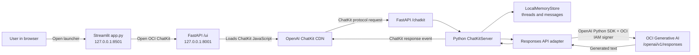

# How the ChatKit + Python + OCI Responses API sample works

This document explains how the sample connects an OpenAI ChatKit browser interface to a Python backend that sends model requests to OCI Generative AI. ChatKit supplies the chat experience and protocol; OCI supplies the model response.

## Architecture at a glance



The browser never receives OCI signing credentials. The Python process signs the request and connects directly to OCI. OpenAI's CDN hosts the ChatKit JavaScript component; it does not host the model used by this sample.

## What each file does

| File | Responsibility |
| --- | --- |
| `app.py` | Displays the Streamlit launcher, shows the selected region/model/project status, and links to the ChatKit page. It does not call the model. |
| `chatkit_server.py` | Implements the ChatKit store, chat response handler, OCI Responses API client, health endpoint, ChatKit HTML page, and `/chatkit` protocol endpoint. |
| `.env` | Local runtime settings such as region, model, project OCID, auth mode, and URLs. This private file is ignored by Git. |
| `.env.example` | Safe template of supported settings. It contains no credentials. |
| `oci-config.example` | Placeholder OCI config structure for local user-principal authentication. |
| `run.sh` | Starts the FastAPI backend and Streamlit launcher together, both bound to loopback. |
| `requirements.txt` | Python packages used by the application. |

## A message from browser to model and back

1. **The launcher opens the chat page.** Streamlit reads `.env`, shows configuration status, and links to `http://127.0.0.1:8001/ui`.
2. **The page initializes ChatKit.** FastAPI returns a small HTML page that loads ChatKit's web component from OpenAI's CDN. The page calls `setOptions()` with this backend's `/chatkit` URL and the development domain key `local-dev`.
3. **ChatKit sends its protocol request.** The browser posts the ChatKit payload to FastAPI's `/chatkit` endpoint. The endpoint passes the payload to `ChatKitServer.process()`. ChatKit handles thread/session protocol and coordinates calls into the custom server implementation.
4. **The custom server rebuilds the prompt history.** `OciChatKitServer.respond()` loads up to 40 recent thread items from `LocalMemoryStore`, orders them oldest-to-newest, extracts text, and maps user and assistant items to OpenAI-style `{role, content}` messages. Other item types are skipped.
5. **Python authenticates and calls OCI.** `_call_oci_responses()` reads the OCI region, project OCID, model ID, and auth mode. It creates an OCI signer and gives it to an `httpx.Client`. The OpenAI Python SDK sends `client.responses.create(...)` to:

   ```text
   https://inference.generativeai.<region>.oci.oraclecloud.com/openai/v1/responses
   ```

   The request includes the selected model and project. The SDK's required `api_key` argument is set to the literal `not-used`; that string is not a credential. OCI IAM request signing is the authentication mechanism.

6. **The answer returns through ChatKit.** The backend reads `response.output_text`, wraps it in an `AssistantMessageItem`, and yields a `ThreadItemDoneEvent`. ChatKit renders that result in the browser.

## The two integration points in Python

The FastAPI route hands ChatKit's request body to the Python SDK's protocol handler. This keeps ChatKit request parsing and thread lifecycle in the ChatKit package:

```python
@app.post("/chatkit")
async def chatkit_endpoint(request: Request) -> Response:
    result = await server.process(await request.body(), context={})
    if isinstance(result, StreamingResult):
        return StreamingResponse(result, media_type="text/event-stream")
    return Response(content=result.json, media_type="application/json")
```

The custom `respond()` method builds model input from stored ChatKit items, calls the OCI adapter, then returns the answer in ChatKit's item/event format. The adapter uses the regular OpenAI Python client, pointed at OCI's compatible endpoint and supplied with an OCI HTTP signer:

```python
http_client = httpx.Client(auth=signer)
with OpenAI(
    base_url=f"https://inference.generativeai.{region}.oci.oraclecloud.com/openai/v1",
    api_key="not-used",
    project=project_ocid,
    http_client=http_client,
) as client:
    response = client.responses.create(
        model=model_id,
        instructions="You are a helpful assistant. Be clear and concise.",
        input=model_input,
    )
answer = response.output_text
```

In `chatkit_server.py`, the signer is selected immediately before creating this client: `OciUserPrincipalAuth` for local use or `OciInstancePrincipalAuth` on Compute.

### Streaming detail

The `/chatkit` endpoint supports ChatKit's streaming response type. In the current sample, however, the OCI request runs to completion before the backend yields its assistant item. The model text is therefore delivered as a completed message, not token-by-token. `asyncio.to_thread()` runs the synchronous OpenAI SDK request outside FastAPI's async event loop so one model call does not block that loop.

## How history and storage work

`LocalMemoryStore` keeps thread metadata and items in Python dictionaries. Each turn sends the latest 40 stored user/assistant text items back to OCI as input. The sample does not rely on OCI-hosted conversation state or pass a `previous_response_id`.

This store is intended for a local demo: it is lost when the Python backend restarts, is not shared between multiple server workers, and does not isolate threads by signed-in user. The app does not currently implement end-user authentication, Oracle SSO, file uploads, or durable storage.

## Authentication modes

### Local development: OCI user principal

Set `OCI_AUTH_MODE=user` in `.env`. The backend creates `OciUserPrincipalAuth` with `OCI_CONFIG_FILE` and `OCI_PROFILE_NAME`. The signer reads the OCI config and uses the user's OCI API signing key to sign each request.

Keep the OCI private key and config on the local machine. Do not commit either file or put the key in the browser, `.env.example`, or source code.

### OCI Compute: instance principal

Set `OCI_AUTH_MODE=instance`. The backend uses `OciInstancePrincipalAuth`, which signs requests as the compute instance. No user's OCI private key or OCI config needs to be copied to the VM. OCI IAM must place the instance in a dynamic group and allow that identity to call the Responses API in the project compartment.

Use a matching rule that selects only the app VM, for example:

```text
All {instance.id = '<compute-instance-ocid>'}
```

The OCI Responses API guide documents the `generative-ai-response` resource and a compartment-scoped policy using that resource. Have the tenancy administrator review the appropriate grant for the instance and project compartment. See the [OCI Responses API quick start](https://docs.oracle.com/en-us/iaas/Content/generative-ai/get-started-agents.htm) and [OCI IAM authentication helper](https://docs.oracle.com/en-us/iaas/Content/generative-ai/oci-genai-auth.htm).

**Current deployment note (19 October 2026):** the code is installed on the OCI Compute VM and configured for instance-principal authentication. A direct model call from that VM returned OCI's `404 Authorization failed or requested resource not found` response. Its existing `use generative-ai-family` grant was insufficient in this tenancy. The systemd unit is installed but left stopped until the Responses API permission is approved. Local user-principal calls have been verified successfully.

## Settings used by the application

| Setting | Meaning |
| --- | --- |
| `OCI_AUTH_MODE` | `user` for local user-principal auth, `instance` for OCI Compute instance-principal auth. |
| `OCI_REGION` | Region used in the OCI Generative AI endpoint and request signing. |
| `OCI_PROJECT_OCID` | Generative AI project associated with each Responses API request. |
| `OCI_MODEL_ID` | Model ID sent to `client.responses.create()`. |
| `OCI_CONFIG_FILE` | OCI config file path for user-principal auth; not required for instance-principal auth. |
| `OCI_PROFILE_NAME` | Profile name in the OCI config file; defaults to `DEFAULT`. |
| `CHATKIT_UI_URL` | ChatKit page opened from Streamlit. |
| `CHATKIT_CORS_ORIGINS` | Browser origins allowed to call the FastAPI backend. |

The `/healthz` endpoint reports whether required settings are present. It does not call OCI and therefore cannot confirm IAM authorization, model availability, or billing access. A successful model response is the end-to-end check.

## Run locally

From the repository directory, create `.env` from `.env.example`, set `OCI_PROJECT_OCID`, and ensure the local OCI profile is configured. Then run:

```bash
./run.sh
```

Open [http://127.0.0.1:8501](http://127.0.0.1:8501), then select **Open OCI ChatKit**. Useful local endpoints:

| URL | What it does |
| --- | --- |
| `http://127.0.0.1:8501/` | Streamlit launcher |
| `http://127.0.0.1:8001/ui` | ChatKit browser page |
| `http://127.0.0.1:8001/chatkit` | ChatKit protocol endpoint |
| `http://127.0.0.1:8001/healthz` | Configuration health check |

Both services bind to `127.0.0.1`; they are not exposed to other computers by default.

## Data and billing path

Chat messages and recent thread history pass from the browser to this Python backend, then from the backend to the configured OCI Generative AI region and project. The backend does not send model requests to the OpenAI API. Model usage is billed and monitored in OCI, not against ChatGPT or Codex credits.

Before sharing beyond a local proof of concept, add HTTPS, user sign-in and authorization, per-user thread isolation, durable storage, secret management, and monitoring. The current app is not an Oracle workforce SSO implementation.
